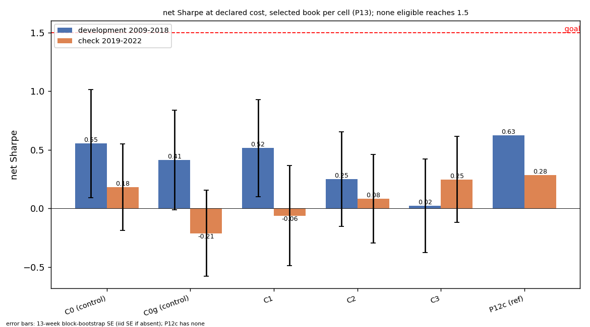

# P13 RESULTS (auto-generated by report.py; do not edit)

- generated: 2026-10-18 15:43
- git HEAD: `a370579829f6983ef951f405d3a787b9036826d8`
- hp_hash: `872821b168bcbcc3`
- refits trained (trainer log lines `MODEL .. trained`): 808
- GOAL: NOT MET

Goal: net Sharpe > 1.5 and MaxDD < 25 % using graph methods. Every Sharpe below is followed by (annualised return, MaxDD).

## 1. Rank IC (seed mean; development 2009-2018 / check 2019-2022)

Cell values: `dev IC (t) / chk IC (t)`. t is the naive per-formation t (no overlap correction). † = no seed-mean file yet; mean over the seed files present.

| cell | W | M | Q |
|---|---|---|---|
| C0 | +0.0181 (t +3.7) / +0.0524 (t +5.2) | +0.0168 (t +1.7) / +0.0542 (t +3.7) | +0.0053 (t +0.3) / +0.0708 (t +3.0) |
| C0g | +0.0165 (t +3.1) / +0.0528 (t +4.9) | +0.0164 (t +1.6) / +0.0564 (t +3.2) | +0.0159 (t +0.9) / +0.0382 (t +1.1) |
| C1 | +0.0168 (t +3.5) / +0.0518 (t +5.0) | +0.0178 (t +1.9) / +0.0572 (t +3.9) | +0.0121 (t +0.7) / +0.0507 (t +2.0) |
| C2 | +0.0143 (t +2.4) / +0.0533 (t +4.8) | +0.0136 (t +1.2) / +0.0550 (t +2.8) | +0.0190 (t +1.0) / +0.0345 (t +0.9) |
| C3 | +0.0131 (t +2.2) / +0.0528 (t +4.7) | +0.0130 (t +1.0) / +0.0592 (t +3.0) | +0.0120 (t +0.6) / +0.0445 (t +1.1) |
| C4 | pending | +0.0209 (t +2.2) / +0.0546 (t +3.5) | +0.0158 (t +0.8) / +0.0471 (t +1.6) |
| C5 | pending | +0.0179 (t +1.6) / +0.0528 (t +2.7) | -0.0004 (t -0.0) / +0.0561 (t +1.4) |

## 2. Books (selected book cell per prediction set, declared cost of its universe)

Format: `net Sharpe (ann %, MaxDD %)`. Drift = turnover charged against drifted weights. SE = Sharpe standard error (iid / 13-week block bootstrap). **bold** = best eligible cell by the rule (highest dev net Sharpe with dev MaxDD >= -25 %).

| cell | eligible | selected book (cost bps) | dev net | chk net | dev gross | chk gross | dev drift-charged | chk drift-charged | SE dev | SE chk |
|---|---|---|---|---|---|---|---|---|---|---|
| C0 | no | `R1_weekly_TOP500_theta0.5` (net_2bps) | +0.55 (+1.7 %, DD -13.6 %) | +0.18 (+1.1 %, DD -9.8 %) | 0.82 | 0.31 | +0.55 (+1.7 %, DD -13.6 %) | +0.18 (+1.1 %, DD -9.8 %) | 0.32 / 0.46 | 0.51 / 0.37 |
| C0g | no | `R1_weekly_TOP500_theta0.5` (net_2bps) | +0.41 (+1.3 %, DD -11.8 %) | -0.21 (-1.4 %, DD -15.4 %) | 0.67 | -0.10 | +0.41 (+1.3 %, DD -11.8 %) | -0.21 (-1.4 %, DD -15.4 %) | 0.32 / 0.42 | 0.51 / 0.37 |
| **C1** | yes | `R4b_blend_WM_TOP500_theta1.0` (net_2bps) | +0.52 (+1.7 %, DD -12.8 %) | -0.06 (-0.4 %, DD -11.4 %) | 0.90 | 0.14 | +0.51 (+1.7 %, DD -12.8 %) | -0.06 (-0.4 %, DD -11.4 %) | 0.32 / 0.41 | 0.51 / 0.43 |
| C2 | yes | `R1_weekly_TOP500_theta0.5` (net_2bps) | +0.25 (+0.8 %, DD -11.0 %) | +0.08 (+0.5 %, DD -8.8 %) | 0.49 | 0.21 | +0.25 (+0.8 %, DD -11.0 %) | +0.08 (+0.5 %, DD -8.8 %) | 0.32 / 0.40 | 0.51 / 0.38 |
| C3 | yes | `R1_weekly_TOP500_theta0.5` (net_2bps) | +0.02 (+0.1 %, DD -16.9 %) | +0.25 (+1.5 %, DD -8.1 %) | 0.26 | 0.37 | +0.02 (+0.1 %, DD -16.9 %) | +0.25 (+1.5 %, DD -8.1 %) | 0.32 / 0.40 | 0.51 / 0.37 |
| C4 | no | pending | pending | pending | pending | pending | pending | pending | pending | pending |
| C5 | yes | pending | pending | pending | pending | pending | pending | pending | pending | pending |
| P12c (reference) | n/a | `R4b_blend_WM_TOP500_theta1.0` (net_2bps) | +0.63 (+1.9 %, DD -11.9 %) | +0.28 (+1.7 %, DD -8.8 %) | 1.07 | 0.49 | n/a | n/a | n/a | n/a |

Target: net Sharpe >= 1.5 on development AND check with MaxDD >= -25 % on both (selected eligible cell: C1, C2, C3, C5).

## 3. Paired dIC (cell minus control, per formation, month-level t; demeaned basis primary, raw secondary)

`*` marks development demeaned t >= 2. Demeaned = prediction and target demeaned within the book's SIC groups.

| cell | vs | h | dev dIC demeaned | chk dIC demeaned | dev dIC raw | chk dIC raw |
|---|---|---|---|---|---|---|
| C1 | C0 | W | +0.0015 (t +1.0) | -0.0023 (t -1.1) | -0.0013 (t -0.7) | -0.0006 (t -0.2) |
| C1 | C0 | M | +0.0041 (t +1.4) | +0.0079 (t +1.8) | +0.0010 (t +0.2) | +0.0030 (t +0.5) |
| C1 | C0 | Q | -0.0046 (t -1.0) | +0.0050 (t +0.7) | +0.0068 (t +1.1) | -0.0201 (t -2.2) |
| C1 | C4 | W | pending | pending | pending | pending |
| C1 | C4 | M | pending | pending | pending | pending |
| C1 | C4 | Q | pending | pending | pending | pending |
| C1 | C0g | W | +0.0029 (t +2.1) * | -0.0014 (t -1.0) | +0.0003 (t +0.2) | -0.0010 (t -0.5) |
| C1 | C0g | M | +0.0023 (t +0.6) | -0.0017 (t -0.2) | +0.0014 (t +0.4) | +0.0008 (t +0.1) |
| C1 | C0g | Q | -0.0084 (t -1.4) | +0.0149 (t +0.8) | -0.0038 (t -0.5) | +0.0126 (t +0.7) |
| C2 | C0 | W | -0.0029 (t -1.9) | -0.0015 (t -0.3) | -0.0039 (t -1.5) | +0.0010 (t +0.3) |
| C2 | C0 | M | +0.0046 (t +0.9) | +0.0027 (t +0.3) | -0.0032 (t -0.5) | +0.0007 (t +0.1) |
| C2 | C0 | Q | +0.0005 (t +0.1) | -0.0033 (t -0.1) | +0.0138 (t +1.4) | -0.0363 (t -1.2) |
| C2 | C4 | W | pending | pending | pending | pending |
| C2 | C4 | M | pending | pending | pending | pending |
| C2 | C4 | Q | pending | pending | pending | pending |
| C2 | C0g | W | -0.0015 (t -1.5) | -0.0006 (t -0.1) | -0.0022 (t -1.2) | +0.0005 (t +0.3) |
| C2 | C0g | M | +0.0028 (t +0.9) | -0.0068 (t -1.7) | -0.0028 (t -0.7) | -0.0015 (t -0.3) |
| C2 | C0g | Q | -0.0034 (t -0.8) | +0.0066 (t +0.8) | +0.0032 (t +0.6) | -0.0037 (t -0.5) |
| C3 | C0 | W | -0.0037 (t -1.7) | -0.0023 (t -0.4) | -0.0050 (t -1.3) | +0.0005 (t +0.1) |
| C3 | C0 | M | +0.0012 (t +0.3) | +0.0062 (t +0.7) | -0.0038 (t -0.5) | +0.0049 (t +0.4) |
| C3 | C0 | Q | -0.0023 (t -0.3) | +0.0033 (t +0.1) | +0.0067 (t +0.6) | -0.0263 (t -0.9) |
| C3 | C4 | W | pending | pending | pending | pending |
| C3 | C4 | M | pending | pending | pending | pending |
| C3 | C4 | Q | pending | pending | pending | pending |
| C3 | C0g | W | -0.0022 (t -1.5) | -0.0014 (t -0.3) | -0.0034 (t -1.2) | +0.0000 (t +0.1) |
| C3 | C0g | M | -0.0005 (t -0.1) | -0.0034 (t -0.7) | -0.0033 (t -0.6) | +0.0027 (t +0.4) |
| C3 | C0g | Q | -0.0062 (t -0.9) | +0.0132 (t +1.3) | -0.0039 (t -0.4) | +0.0064 (t +0.5) |
| C5 | C0 | W | pending | pending | pending | pending |
| C5 | C0 | M | pending | pending | pending | pending |
| C5 | C0 | Q | pending | pending | pending | pending |
| C5 | C4 | W | pending | pending | pending | pending |
| C5 | C4 | M | pending | pending | pending | pending |
| C5 | C4 | Q | pending | pending | pending | pending |
| C5 | C0g | W | pending | pending | pending | pending |
| C5 | C0g | M | pending | pending | pending | pending |
| C5 | C0g | Q | pending | pending | pending | pending |

C4 spread (development, demeaned): cell mean vs each of the three C4 draws (min / max / sd), and the seed-paired dIC (C_i vs C4_i; mean / sd).

pending (no dIC vs C4 files yet)

## 4. Label-shift diagnostic (seed 0; shifted-label model vs real model)

Declared rule: signal persists under a one-year label shift if shifted dev IC > 0 with t >= 2 AND >= 0.5 x real dev IC; then a pass is relabelled "not attributable to current information".

| cell | h | shifted dev IC (t) | shifted chk IC (t) | real dev IC (t) | real chk IC (t) | shifted/real (dev) | persists under shift |
|---|---|---|---|---|---|---|---|
| C2 | M (K=13) | +0.0089 (t +0.9) | +0.0005 (t +0.0) | +0.0187 (t +1.7) | +0.0504 (t +2.5) | 0.48 | False |
| C2 | Q (K=5) | +0.0193 (t +1.0) | -0.0122 (t -0.3) | +0.0141 (t +0.8) | +0.0306 (t +0.9) | 1.37 | False |
| C3 | M (K=13) | +0.0089 (t +0.8) | +0.0134 (t +0.6) | +0.0119 (t +0.9) | +0.0457 (t +2.3) | 0.74 | False |
| C3 | Q (K=5) | +0.0242 (t +1.2) | -0.0278 (t -0.7) | +0.0074 (t +0.4) | +0.0309 (t +0.9) | 3.28 | False |

## 5. Selection (selection.py)

selection.py not yet run (books pending: C5)

## 6. Figure

Title (computed from the data): net Sharpe at declared cost, selected book per cell (P13); none eligible reaches 1.5.
